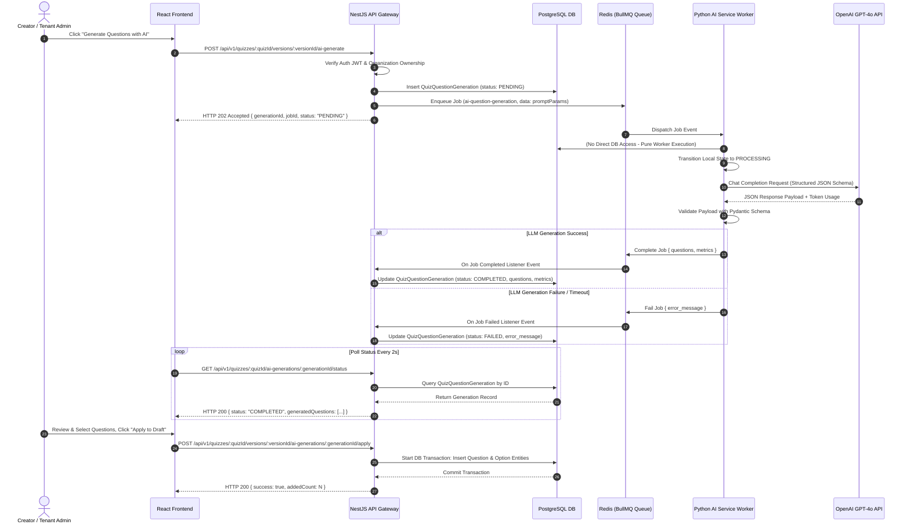

# Architecture Specification: Phase 4.1 AI-Powered Question Generation

**Document Version:** 1.0.0  
**Status:** Approved Architectural Foundations  
**Author:** Principal Software Architect  
**Target System:** Institutional Quiz Platform (`quiz-platform`)  

---

## 1. Architectural Overview & Component Boundaries

The AI-powered question generation system introduces scalable, decoupled, and async-first background processing to the quiz platform. It maintains strict boundary isolation between web API management, data persistence, queue orchestration, and stateless AI computation.

```
+---------------------------------------------------------------------------------------+
|                                    FRONTEND (React)                                   |
|   - Trigger AI Generation Modal                                                       |
|   - Poll Generation Job Status                                                        |
|   - Preview & Select Generated Questions                                              |
|   - Apply Questions to Quiz Draft Version                                             |
+--------------------------------------------------+------------------------------------+
                                                   | HTTP REST APIs
                                                   v
+---------------------------------------------------------------------------------------+
|                                    NESTJS API SERVER                                  |
|   - Authenticates User & Enforces Tenant Boundaries                                   |
|   - Owns PostgreSQL (TypeORM Entities: Quiz, QuizVersion, QuizQuestionGeneration)     |
|   - Produces BullMQ Jobs (`ai-question-generation`)                                    |
|   - Applies Approved AI Questions into Draft Quiz Versions                            |
+--------------------------+------------------------------------------------------------+
                           | Redis Connection / Job Producer & Listener
                           v
+---------------------------------------------------------------------------------------+
|                                  REDIS QUEUE & BROKER                                 |
|   - BullMQ Queue: `ai-question-generation`                                            |
|   - Manages Job States (Waiting, Active, Completed, Failed)                           |
|   - Handles Retries & Backoff                                                         |
+--------------------------+------------------------------------------------------------+
                           | Queue Consumer Engine
                           v
+---------------------------------------------------------------------------------------+
|                                PYTHON FASTAPI AI SERVICE                              |
|   - Purely Stateless (NO DIRECT ACCESS TO POSTGRESQL)                                 |
|   - BullMQ Worker Listener                                                            |
|   - Pydantic Schema Validation & Sanitization                                         |
|   - LLM Provider Abstraction Layer (OpenAI API Integration)                           |
|   - System & Few-Shot Prompt Construction                                             |
+---------------------------------------------------------------------------------------+
```

### Component Responsibility Breakdown

1. **NestJS API Server (API Gateway & Data Owner)**
   - **Authentication & Authorization:** Verifies JWT credentials and ensures users can only request generation for quizzes within their own organization (`organizationId` tenant match).
   - **PostgreSQL Owner:** Only NestJS interacts with the database. Manages lifecycle state in the `quiz_question_generations` table.
   - **Queue Producer:** Enqueues question generation jobs into Redis via `@nestjs/bullmq`.
   - **Draft Version Mutation:** Executes database transactions to convert raw AI JSON payloads into formal `Question` and `Option` entities upon user approval.

2. **Redis & BullMQ (Distributed Message Broker)**
   - Holds async job queues (`ai-question-generation`).
   - Ensures job idempotency, locks, delayed retries, and failure backoff strategies.

3. **Python FastAPI AI Service (Stateless Computation Engine)**
   - **Database Isolation:** Has **zero** connection to PostgreSQL.
   - **Worker Listener:** Consumes jobs from the `ai-question-generation` queue.
   - **LLM Abstraction Layer:** Renders domain-tailored prompts and queries LLMs (OpenAI `gpt-4o` / `gpt-4o-mini`) using structured JSON outputs (`response_format={"type": "json_object"}` or Structured Outputs).
   - **Validation:** Validates output with Pydantic prior to returning job completion data back to BullMQ.

---

## 2. Data Model Design (`quiz_question_generations`)

To track async job states, audit parameters, store raw AI outputs, and record token metrics, a dedicated table `quiz_question_generations` is added to PostgreSQL.

### 2.1 Database Schema (DDL)

```sql
CREATE TYPE generation_status_enum AS ENUM (
  'PENDING',
  'PROCESSING',
  'COMPLETED',
  'FAILED',
  'CANCELLED'
);

CREATE TABLE quiz_question_generations (
    id UUID PRIMARY KEY DEFAULT gen_random_uuid(),
    organization_id UUID NOT NULL REFERENCES organizations(id) ON DELETE RESTRICT,
    creator_id UUID NOT NULL REFERENCES users(id) ON DELETE RESTRICT,
    quiz_id UUID NOT NULL REFERENCES quizzes(id) ON DELETE RESTRICT,
    target_version_id UUID NOT NULL REFERENCES quiz_versions(id) ON DELETE RESTRICT,
    job_id VARCHAR(255) NOT NULL UNIQUE,
    status generation_status_enum NOT NULL DEFAULT 'PENDING',
    prompt_params JSONB NOT NULL,
    generated_questions JSONB DEFAULT NULL,
    error_message TEXT DEFAULT NULL,
    tokens_used JSONB DEFAULT NULL,
    created_at TIMESTAMPTZ NOT NULL DEFAULT NOW(),
    updated_at TIMESTAMPTZ NOT NULL DEFAULT NOW(),
    completed_at TIMESTAMPTZ DEFAULT NULL
);

-- Indexes for fast tenant filtering & lookup
CREATE INDEX idx_generations_org_quiz ON quiz_question_generations (organization_id, quiz_id);
CREATE INDEX idx_generations_status ON quiz_question_generations (status, created_at);
CREATE UNIQUE INDEX idx_generations_job_id ON quiz_question_generations (job_id);
```

### 2.2 TypeORM Entity Specification (`apps/api/src/modules/quizzes/entities/quiz-question-generation.entity.ts`)

```typescript
import {
  Column,
  CreateDateColumn,
  Entity,
  Index,
  JoinColumn,
  ManyToOne,
  PrimaryGeneratedColumn,
  UpdateDateColumn,
} from 'typeorm';

import { Organization } from '../../organizations/entities/organization.entity.js';
import { User } from '../../users/entities/user.entity.js';
import { Quiz } from './quiz.entity.js';
import { QuizVersion } from './quiz-version.entity.js';

export enum GenerationStatus {
  PENDING = 'PENDING',
  PROCESSING = 'PROCESSING',
  COMPLETED = 'COMPLETED',
  FAILED = 'FAILED',
  CANCELLED = 'CANCELLED',
}

export interface PromptParamsPayload {
  topic: string;
  targetQuestionCount: number;
  questionTypes: string[];
  difficulty: 'easy' | 'medium' | 'hard';
  bloomTaxonomyLevel?: string;
  customInstructions?: string;
  language?: string;
}

export interface TokensUsedPayload {
  promptTokens: number;
  completionTokens: number;
  totalTokens: number;
  modelName: string;
  executionTimeMs: number;
}

@Entity('quiz_question_generations')
@Index(['organizationId', 'quizId'])
export class QuizQuestionGeneration {
  @PrimaryGeneratedColumn('uuid')
  id: string;

  @Column({ name: 'organization_id', type: 'uuid' })
  organizationId: string;

  @ManyToOne(() => Organization, { onDelete: 'RESTRICT' })
  @JoinColumn({ name: 'organization_id' })
  organization: Organization;

  @Column({ name: 'creator_id', type: 'uuid' })
  creatorId: string;

  @ManyToOne(() => User, { onDelete: 'RESTRICT' })
  @JoinColumn({ name: 'creator_id' })
  creator: User;

  @Column({ name: 'quiz_id', type: 'uuid' })
  quizId: string;

  @ManyToOne(() => Quiz, { onDelete: 'RESTRICT' })
  @JoinColumn({ name: 'quiz_id' })
  quiz: Quiz;

  @Column({ name: 'target_version_id', type: 'uuid' })
  targetVersionId: string;

  @ManyToOne(() => QuizVersion, { onDelete: 'RESTRICT' })
  @JoinColumn({ name: 'target_version_id' })
  targetVersion: QuizVersion;

  @Column({ name: 'job_id', type: 'varchar', length: 255, unique: true })
  jobId: string;

  @Column({
    type: 'enum',
    enum: GenerationStatus,
    default: GenerationStatus.PENDING,
  })
  status: GenerationStatus;

  @Column({ name: 'prompt_params', type: 'jsonb' })
  promptParams: PromptParamsPayload;

  @Column({ name: 'generated_questions', type: 'jsonb', nullable: true })
  generatedQuestions: Record<string, any>[] | null;

  @Column({ name: 'error_message', type: 'text', nullable: true })
  errorMessage: string | null;

  @Column({ name: 'tokens_used', type: 'jsonb', nullable: true })
  tokensUsed: TokensUsedPayload | null;

  @CreateDateColumn({ name: 'created_at' })
  createdAt: Date;

  @UpdateDateColumn({ name: 'updated_at' })
  updatedAt: Date;

  @Column({ name: 'completed_at', type: 'timestamptz', nullable: true })
  completedAt: Date | null;
}
```

---

## 3. NestJS API Contracts & DTOs

### 3.1 Endpoint Summary

| Method | Endpoint Path | Description | Access Control |
|---|---|---|---|
| `POST` | `/api/v1/quizzes/:quizId/versions/:versionId/ai-generate` | Queues new AI generation job | `TENANT_ADMIN`, `CREATOR` |
| `GET` | `/api/v1/quizzes/:quizId/ai-generations/:generationId/status` | Polls generation status & results | `TENANT_ADMIN`, `CREATOR` |
| `POST` | `/api/v1/quizzes/:quizId/versions/:versionId/ai-generations/:generationId/apply` | Applies accepted AI questions into draft version | `TENANT_ADMIN`, `CREATOR` |
| `GET` | `/api/v1/quizzes/:quizId/ai-generations` | Lists past generation requests for quiz | `TENANT_ADMIN`, `CREATOR` |

---

### 3.2 Request DTO: `GenerateQuestionsDto`

```typescript
import {
  IsArray,
  IsEnum,
  IsInt,
  IsNotEmpty,
  IsOptional,
  IsString,
  Max,
  Min,
} from 'class-validator';
import { QuestionType } from '../enums/question-type.enum.js';

export enum DifficultyLevel {
  EASY = 'easy',
  MEDIUM = 'medium',
  HARD = 'hard',
}

export class GenerateQuestionsDto {
  @IsString()
  @IsNotEmpty()
  topic: string;

  @IsInt()
  @Min(1)
  @Max(20)
  targetQuestionCount: number;

  @IsArray()
  @IsEnum(QuestionType, { each: true })
  questionTypes: QuestionType[];

  @IsEnum(DifficultyLevel)
  difficulty: DifficultyLevel;

  @IsOptional()
  @IsString()
  bloomTaxonomyLevel?: string;

  @IsOptional()
  @IsString()
  customInstructions?: string;

  @IsOptional()
  @IsString()
  language?: string = 'en';
}
```

---

### 3.3 Response DTO: `GenerateQuestionsResponseDto`

```typescript
import { GenerationStatus } from '../entities/quiz-question-generation.entity.js';

export class GenerateQuestionsResponseDto {
  generationId: string;
  jobId: string;
  status: GenerationStatus;
  estimatedTimeSeconds: number;
  createdAt: string;
}
```

---

### 3.4 Response DTO: `GenerationStatusResponseDto`

```typescript
import { GenerationStatus, TokensUsedPayload } from '../entities/quiz-question-generation.entity.js';

export class GeneratedOptionPreviewDto {
  text: string;
  isCorrect: boolean;
  explanation?: string;
}

export class GeneratedQuestionPreviewDto {
  text: string;
  questionType: string;
  marks: number;
  options: GeneratedOptionPreviewDto[];
  explanation?: string;
  bloomTaxonomyLevel?: string;
}

export class GenerationStatusResponseDto {
  generationId: string;
  jobId: string;
  status: GenerationStatus;
  generatedQuestions: GeneratedQuestionPreviewDto[] | null;
  errorMessage: string | null;
  tokensUsed: TokensUsedPayload | null;
  completedAt: string | null;
}
```

---

### 3.5 Request DTO: `ApplyGeneratedQuestionsDto`

```typescript
import { IsArray, IsBoolean, IsInt, IsOptional, Min } from 'class-validator';

export class ApplyGeneratedQuestionsDto {
  @IsOptional()
  @IsArray()
  @IsInt({ each: true })
  @Min(0, { each: true })
  selectedIndices?: number[];

  @IsOptional()
  @IsBoolean()
  overwriteExisting?: boolean = false;
}
```

---

## 4. Python Pydantic Data Contracts

Located in `apps/ai/app/schemas/question_generation.py`:

```python
from enum import Enum
from typing import List, Optional
from pydantic import BaseModel, Field, model_validator

class QuestionTypeEnum(str, Enum):
    SINGLE_CHOICE = "single_choice"
    MULTIPLE_CHOICE = "multiple_choice"
    TRUE_FALSE = "true_false"

class DifficultyEnum(str, Enum):
    EASY = "easy"
    MEDIUM = "medium"
    HARD = "hard"

class GeneratedOptionSchema(BaseModel):
    text: str = Field(..., description="The answer option text")
    is_correct: bool = Field(..., description="True if this option is a correct answer")
    explanation: Optional[str] = Field(None, description="Explanation for why option is correct or incorrect")

class GeneratedQuestionSchema(BaseModel):
    text: str = Field(..., description="The main question prompt")
    question_type: QuestionTypeEnum = Field(..., description="Type of question")
    marks: int = Field(default=1, ge=1, le=10, description="Points awarded for correct answer")
    options: List[GeneratedOptionSchema] = Field(..., description="List of options")
    explanation: Optional[str] = Field(None, description="General solution explanation")
    bloom_taxonomy_level: Optional[str] = Field(None, description="Target Bloom's taxonomy category")

    @model_validator(mode="after")
    def validate_options_rule(self):
        if self.question_type == QuestionTypeEnum.TRUE_FALSE:
            if len(self.options) != 2:
                raise ValueError("True/False questions must contain exactly 2 options.")
            correct_count = sum(1 for opt in self.options if opt.is_correct)
            if correct_count != 1:
                raise ValueError("True/False questions must have exactly 1 correct option.")
        elif self.question_type == QuestionTypeEnum.SINGLE_CHOICE:
            if len(self.options) < 2:
                raise ValueError("Single choice questions must contain at least 2 options.")
            correct_count = sum(1 for opt in self.options if opt.is_correct)
            if correct_count != 1:
                raise ValueError("Single choice questions must have exactly 1 correct option.")
        elif self.question_type == QuestionTypeEnum.MULTIPLE_CHOICE:
            if len(self.options) < 2:
                raise ValueError("Multiple choice questions must contain at least 2 options.")
            correct_count = sum(1 for opt in self.options if opt.is_correct)
            if correct_count < 1:
                raise ValueError("Multiple choice questions must have at least 1 correct option.")
        return self

class LLMGenerationResponse(BaseModel):
    questions: List[GeneratedQuestionSchema]

class LLMExecutionMetrics(BaseModel):
    prompt_tokens: int
    completion_tokens: int
    total_tokens: int
    model_name: str
    execution_time_ms: int

class WorkerJobResult(BaseModel):
    generation_id: str
    status: str
    questions: List[GeneratedQuestionSchema]
    metrics: LLMExecutionMetrics
    error_message: Optional[str] = None
```

---

## 5. BullMQ / Redis Integration Architecture

### 5.1 Queue Topology
- **Queue Name:** `ai-question-generation`
- **Prefix:** `{bull}`

### 5.2 BullMQ Job Payload (Produced by NestJS)

```typescript
export interface AiQuestionGenerationJobData {
  generationId: string;
  organizationId: string;
  creatorId: string;
  quizId: string;
  targetVersionId: string;
  promptParams: {
    topic: string;
    targetQuestionCount: number;
    questionTypes: string[];
    difficulty: string;
    bloomTaxonomyLevel?: string;
    customInstructions?: string;
    language?: string;
  };
}
```

### 5.3 Queue Settings & Resilience Config
- **Attempts:** 3
- **Backoff:** Exponential (`type: 'exponential'`, `delay: 3000` ms)
- **Job Retention:** `removeOnComplete: { age: 86400, count: 500 }`, `removeOnFail: { age: 604800, count: 1000 }`
- **Concurrency (Python Worker):** 5 concurrent workers per container instance.

---

## 6. LLM Provider Abstraction Layer

Located in `apps/ai/app/providers/base.py` & `apps/ai/app/providers/openai_provider.py`:

```python
# apps/ai/app/providers/base.py
from abc import ABC, abstractmethod
from typing import Tuple
from app.schemas.question_generation import QuestionGenerationParams, LLMGenerationResponse, LLMExecutionMetrics

class BaseLLMProvider(ABC):
    @abstractmethod
    async def generate_questions(
        self, params: QuestionGenerationParams
    ) -> Tuple[LLMGenerationResponse, LLMExecutionMetrics]:
        """Abstract method to query LLM and return validated questions with token metrics."""
        pass
```

### 6.1 System & Few-Shot Prompt Specification

The `OpenAIProvider` enforces JSON output parsing (`response_format={"type": "json_object"}` or Structured Outputs using `beta.chat.completions.parse`).

**System Prompt Template:**
```text
You are an expert institutional assessment creator specializing in writing high-quality, pedagogically sound test questions.

Rules:
1. Format your response strictly adhering to the requested JSON schema.
2. For single_choice: produce at least 4 options with EXACTLY 1 correct option.
3. For multiple_choice: produce at least 4 options with AT LEAST 1 correct option.
4. For true_false: produce EXACTLY 2 options ("True" and "False") with EXACTLY 1 correct option.
5. Provide clear, educational explanations for each question and option where helpful.
6. Ensure questions match the specified difficulty and Bloom's taxonomy level.
```

---

## 7. Security, Tenant Isolation & Reliability

1. **Tenant Isolation:**
   - Every request is validated against the authenticated user's `organizationId`.
   - NestJS rejects generation requests where `quiz.organizationId != user.organizationId`.

2. **Rate Limiting & Quota Controls:**
   - Rate limiting guard enforced via Redis (`max 10 AI generations per organization per hour`).

3. **Input Sanitization:**
   - Strips malicious control characters and prompt injection attempts from `topic` and `customInstructions`.

4. **Failure Resilience:**
   - If the Python worker throws an unhandled exception or LLM times out, NestJS job failure listener catches the BullMQ failure event and sets database status to `FAILED` with the corresponding `error_message`.

---

## 8. End-to-End Sequence Diagram



---

## 9. Required Package Dependencies Matrix

To implement Phase 4.2+, the following packages will be added to `package.json` and `requirements.txt`:

### `apps/api/package.json` Dependencies
```json
{
  "dependencies": {
    "bullmq": "^5.41.0",
    "@nestjs/bullmq": "^11.0.2",
    "ioredis": "^5.6.0"
  }
}
```

### `apps/ai/requirements.txt` Dependencies
```text
openai>=1.60.0
tenacity>=9.0.0
python-bullmq>=0.1.0  # or custom Redis worker stream consumer
```

---

## 10. Phase 4.1 Deliverables Checklist Matrix

| # | Deliverable | Description | Status |
|---|---|---|---|
| 1 | Component Architecture | Clear boundary separation: NestJS (DB owner), BullMQ (Broker), Python (Stateless AI) | Completed & Specified |
| 2 | Data Model (`quiz_question_generations`) | TypeORM Entity & SQL DDL with tenant FKs, JSONB payloads, token metrics | Completed & Specified |
| 3 | NestJS Controller & DTO Contracts | Full request/response TS DTOs (`GenerateQuestionsDto`, status, apply) | Completed & Specified |
| 4 | Pydantic Schemas | Strict Python v2 models with custom validation rules per question type | Completed & Specified |
| 5 | BullMQ Topology | Queue naming, concurrency, retention, backoff retries | Completed & Specified |
| 6 | LLM Abstraction Layer Design | `BaseLLMProvider` interface and `OpenAIProvider` implementation design | Completed & Specified |
| 7 | Prompt Specification | Structured system prompts and JSON mode enforcement rules | Completed & Specified |
| 8 | Security & Tenant Boundaries | Multi-tenant JWT authorization, rate limit counters, prompt injection guards | Completed & Specified |
| 9 | Failure Recovery & Resilience | Job retry strategy and database status lifecycle sync | Completed & Specified |
| 10 | Frontend UX Integration Plan | Modal flow, status polling strategy, preview & apply mechanism | Completed & Specified |
| 11 | Sequence Diagram | Mermaid sequence diagram detailing end-to-end async execution | Completed & Specified |
| 12 | Dependencies Matrix | Comprehensive dependency additions for Node.js and Python packages | Completed & Specified |
